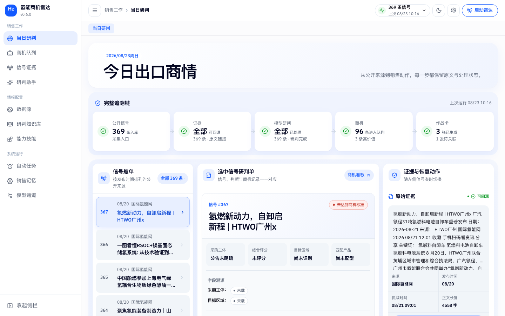
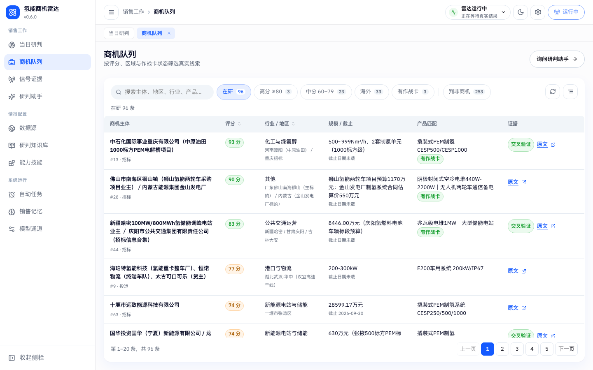
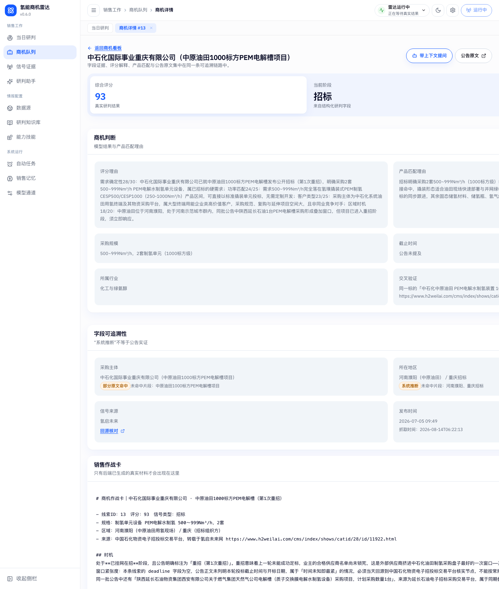
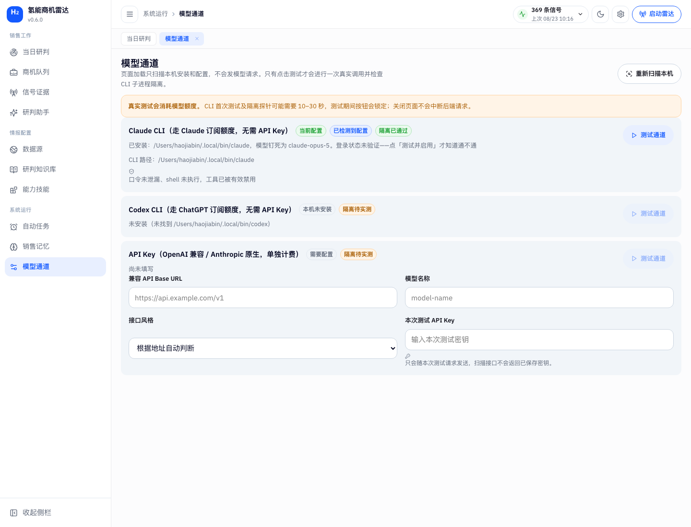

# 氢能商机雷达 · 评审使用说明

**v1.0.0** · 浦发·IGNITE 未来能源黑客松 · 赛题 T04「氢能产业商机与精准获客 Agent」· 企业方：氢璞创能

---

## 一、这东西解决什么问题

氢璞创能的销售要在公开招投标信息里找到「谁要买电解槽 / 燃料电池」，
但公开公告分散在十几个行业站点，且大部分与氢能无关。人工筛选一天看不完两百条。

本系统做四件事：

1. 从氢能行业公开网站**真实抓取**招标 / 中标 / 项目公告
2. 用大模型抽取商机字段，按**需求确定性 / 功率匹配 / 客户类型 / 区域时机**四维打分
3. 匹配氢璞创能的产品型号（CESP 系列）
4. 给高分商机生成可直接用的**销售作战卡**（时机、推荐配置、切入话术、下一步）

**产品的立身之本是可追溯**：界面上每一个字段都能回到公告原文核对，
模型推断出来的值会被明确标成「系统推断」，不会伪装成公告实证值。
下面第三节请重点看这一条——**这是我们最希望被现场证伪的地方**。

---

## 二、怎么打开

**本文全部内容以本地运行的 v1.0.0 为准。**

前置：`python3.11`、`uv`、`sqlite3`；本机已登录 `claude` CLI。

```bash
cd radar && uv venv --python 3.11 && uv pip install -r requirements.txt
bash radar/run.sh
```

`run.sh` 会依次跑完：建库 → 爬取 → 抽取评分 → 重复归并 → 产品匹配 → 生成作战卡 → 起服务。
跑完打开 <http://127.0.0.1:8000> 即是看板。

> 仓库已包含前端构建产物，未装 Node.js 也能直接起后端。
> 若 `claude` CLI 未登录，`run.sh` 会**跳过**抽取/匹配/作战卡并在终端明确提示——
> 按项目规矩此时不使用任何替代数据。在终端执行一次 `claude /login` 即可解除。

---

## 三、五分钟验证路径

按这个顺序走一遍，就能判断这套东西是不是真的。

### 第 1 步 · 首页看链路有没有损耗

打开首页「当日研判」，最上面是**完整追溯链**。



链路读作 `369 条入库 → 全部可回源 → 全部已研判 → 96 条进入队列 → 3 张作战卡`。
「全部」表示这一环没有损耗；**数字在哪一步变小，就是链路在哪一步收窄**。
撰写时是 369 条信号里 96 条被判为商机、253 条被判非商机——
判非的那 253 条不会被藏起来，见第 2 步。

下方三栏是工作台：左边选信号 → 中间看研判 → 右边核证据，三栏联动。
随便点左栏一条信号，中间和右边会同步换成那一条。

### 第 2 步 · 商机队列看筛选口径



筛选条是这一页唯一的筛选控件，每个 chip 后面挂着计数：

```
在研 96 | 高分 ≥80 3 | 中分 60–79 23 | 海外 33 | 有作战卡 3  ‖  判非商机 253
```

竖线右边是**另一个范围**——253 条判非商机不和「在研」混在同一个分母里。
`96 + 253 = 349`，全部线索都在，没有一条被丢掉。

在搜索框里打个词回车，计数行会说明「共 N 条，关键词命中 M 条」，
旁边挂一个可以点掉的关键词标签——**任何正在生效的过滤条件都看得见、可撤销**。

### 第 3 步 · 打开一条高分商机，验可追溯性 ⭐

这一步最关键。点开评分最高的 **#13 中石化国际事业重庆有限公司**
（或直接访问 `/opportunities/13`）。



往下拉到**「字段可追溯性」**区块，注意这两行：

| 字段 | 值 | 判定 | 未命中原文的片段 |
|---|---|---|---|
| 采购主体 | 中石化国际事业重庆有限公司（中原油田1000标方PEM电解槽项目） | **部分原文命中** | 中原油田1000标方PEM电解槽项目 |
| 所在地区 | 河南濮阳（中原油田）／重庆招标 | **系统推断** | 河南濮阳、重庆招标 |

**请这样证伪它**：点「回源核对」打开公告原文，用 `Ctrl+F` 搜：

| 搜索词 | 结果 |
|---|---|
| 河南濮阳 | **搜不到** |
| 重庆招标 | **搜不到** |
| 中原油田 | 搜得到 |
| PEM电解槽 | 搜得到 |

（原文地址 <https://www.h2weilai.com/cms/index/shows/catid/28/id/11922.html>，
撰写本文时已实测线上页面确实如此。）

这正是我们判定的依据：系统把字段值**逐片段**拿去原文里比对，
只要有一个实质片段找不到出处，整条就标成「系统推断」，不许按命中处理。

为什么较真到这个地步：**「河南濮阳」这个地名正在参与区域维度打分**。
如果用「任一片段命中即算实证」的宽松判法，一个模型推断出来的地名就会被
包装成公告实证值，而它已经影响了这条线索的分数。

同一页面往下是**销售作战卡**——只有后端已生成的真实材料才会出现在这里，
没有作战卡的线索不会显示一个假的「生成」按钮。

### 第 4 步 · 确认模型是真的在跑

进「模型通道」页。



- 页面**加载时只扫描本机安装与配置，不发模型请求**；只有点「测试通道」才会真实调一次
- 当前通道 `Claude CLI`，状态「隔离已通过」——
  意思是我们跑过一个隔离探针：如果子进程能读到目录外的口令、或能执行 shell，
  该通道会被直接拒绝启用
- Codex CLI 本机未安装，界面如实标注「本机未安装」，不可选

**这套系统里没有任何 mock、预置应答或规则引擎兜底。**
模型通道不通时，抽取 / 匹配 / 作战卡全部停做并如实报错，而不是用假数据把流程凑通。

### 第 5 步 · 一条命令跑硬指标

```bash
bash radar_accept.sh
```

这个脚本直接查数据库做断言，并**抽样回访 5 条公告 URL 核对 HTTP 状态码**，
最后调接口验证。看到 `ACCEPT PASS` 才算通过。

它检查的门槛：正文超 100 字的信号 ≥10 条、含评分理由的线索 ≥8 条、
完成产品匹配 ≥6 条、作战卡 ≥3 张且每张都含「时机 / 推荐配置 / 切入话术 / 下一步」四个小节、
`PROGRESS.md` 中 `LLM_MODE: live`。

> 脚本头部写明**执行者不得修改**。它报错就去改代码，不许改脚本让它通过。

---

## 四、界面地图

| 入口 | 干什么 |
|---|---|
| **当日研判** | 首页。链路健康 → 选信号 → 核判断与证据 → 销售动作，一屏走完 |
| **商机队列** | 全部线索，按评分 / 区域 / 作战卡状态筛选 |
| **信号证据** | 抓取入库的公开公告原始记录，标题始终链到原站 |
| **研判助手** | 基于真实商机上下文提问；模型提出的动作需你确认后才执行 |
| 数据源 | 信源管理。新站点先经真实抓取探测，确认列表页与正文选择器后才能加入 |
| 研判知识库 | 行业分类、评分权重、产品判断规则。保存前后端解析校验，不合法不覆盖 |
| 能力技能 | 可装配的分析技能（`skills/*.md`），增删改启停 |
| 自动任务 | 采集时段设置。撰写时为每天 9 点与 14 点各一轮 |
| 销售记忆 | 稳定的关注偏好，每轮对话都会读取 |
| 模型通道 | 三选一：Claude CLI / Codex CLI / API Key。切换时后端实测，测不过不保存 |

右上角常驻：采集链路状态、**启动雷达**（手动发起一轮真实采集）、明暗切换、界面设置。

**界面设置**里可以现场调主题色、圆角、卡片形态、内容宽度——
换主题色时请注意：评分徽章的绿 / 琥珀 / 红**不会跟着变**，
那是状态语义，不归主题色管。

---

## 五、看到空态或阻塞时，那是设计不是故障

这是评审时最容易误判的一点，单列出来：

| 你看到的 | 含义 |
|---|---|
| 「尚无关联记录」 | 接口返回真实空列表，不是加载失败 |
| 「研判受阻」 | 模型通道不通，抽取停做。**与「无记录」严格区分**，不会被空态吞掉 |
| 「公告未提及」「日期未载」 | 原文里确实没有这个字段，不编造 |
| 「系统推断」琥珀标 | 模型给出的值在原文里找不到全部出处，见第三节 |
| 运行中只有不确定进度条 | 后端不提供阶段百分比，因此不显示任何合成的百分比数字 |
| 正文乱码时隐藏内容并报错 | 抓到的正文编码异常，宁可不显示也不显示乱码 |

---

## 六、数据现状与已知边界

**撰写时的真实数据**（会随采集增长）：

- 入库信号 **369** 条，来自 4 个启用信源：氢启未来 148 / 国际氢能网 86 / TED 欧盟公共采购 74 / 碳索氢能网 61
- 在研商机 **96** 条，判非商机 253 条，重复归并 42 条
- 完成产品匹配 96 条，海外线索 74 条
- 销售作战卡 **3 张可达** + 1 张待关联（那条线索被归并为重复后卡片在界面上已不可达，
  但我们不把它算进总数、也不隐藏它——见首页链路末端「1 张待关联」）

**已知边界，如实列出：**

1. **作战卡只有 3 张可达。** 它只给高分线索生成，不是每条商机都有。
2. **`deadline` 字段空缺率高。** 很多公告正文本身不写截止时间，我们不推断。
3. **有 4 个信源处于停用状态**（金联创、北极星、中国政府采购网、联合国全球采购）。
   遇到 WAF / 验证码 / 登录墙时我们**跳过并记录，不绕过任何人机验证**。
4. **部分抓取正文混入了站点导航文案**（「收藏」「分享」「关键词：」等），
   369 条里约 95 条存在这个问题。界面上摘要已夹断到两行，但底层文本仍不干净，
   正文提取选择器待收紧。
5. **模型通道依赖本机已登录的 `claude` CLI。** 换机器需重新登录一次。
6. **公网 Railway 实例不是完整形态。** 仓库带了 `Dockerfile` / `railway.json`，
   实例也确实跑着（`/healthz` 正常，已采集 150 条真实信号），但它是 **v0.4.0 的旧构建，
   且容器里没有已登录的 `claude` CLI**——模型通道不通，因此研判管线从未在线上跑过，
   商机与作战卡都是 0。界面对此如实标注「模型通道阻止了后续研判」，没有拿假数据填充。
   **要验证完整链路，请按第二节在本地跑。**

---

## 七、项目结构与协作约定

完整的文件结构、两人分工边界与全部硬性规矩写在 **[CLAUDE.md](CLAUDE.md)**，
设计系统（令牌分层、骨架、组件规范）写在 **[DESIGN.md](DESIGN.md)**。

本项目由两人协作，**两人都不直接写代码**，全部改动由 AI 编码助手完成；
`CLAUDE.md` 就是给助手看的唯一约定来源。
